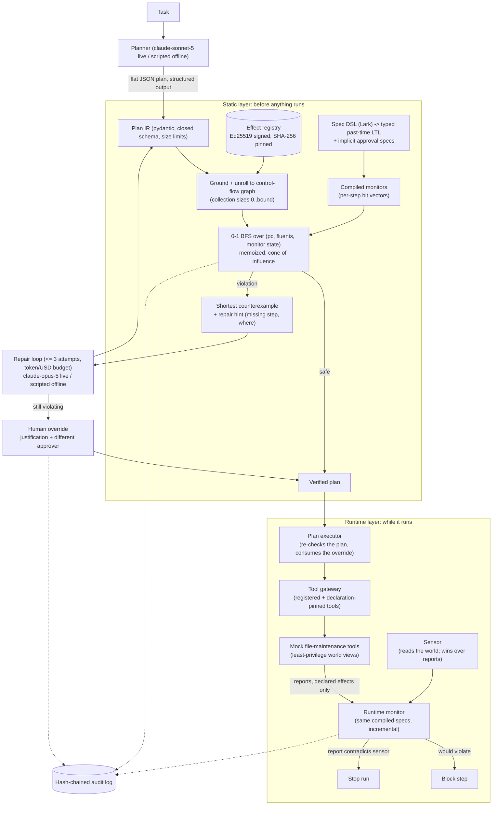

# Plan Model Checker

**An AI agent writes a plan. This checks the plan's step order against safety rules before a
single step runs, and hands back the exact sequence that would go wrong.**

Give a capable model a job like "clean up last year's log directories" and it will write a
sensible-looking plan. The danger is rarely one bad step. It is the order. The delete runs before
the backup finished. The lock is never released on the path where something failed. The service
restarts while it is still taking traffic. A payment call is retried without first checking
whether the first attempt went through.

Those mistakes cost real things. A directory deleted before its backup exists is gone. A lock held
forever is an outage for whoever needs it next. A retried non-idempotent call is a second charge
on a customer's card. Guardrails that inspect one call at a time cannot catch any of this, because
every individual call is fine; it is the sequence that is wrong. And a rule written into a prompt
("always back up first") is a request, not a guarantee.

This project treats a plan as a small program and proves things about it. Rules are written once,
precisely. Every way the plan could run is explored before execution. If a rule can break, you get
the shortest sequence of steps that breaks it, which is usually enough to repair the plan
automatically. The same rules are then enforced again while the plan runs, because a tool that
reports a successful backup has not necessarily made one.

## What this does

- **Checks the whole plan, not each step.** It explores every path the plan could take: both sides
  of every branch, every way a tool can fail, every loop length up to its limit. Then it answers
  one question — can any rule ever be broken?
- **Points at the exact failure.** When a rule can break, it returns a counterexample (a concrete
  run of steps that goes wrong), the shortest one that exists, plus which step is missing and
  where it belongs.
- **Repairs the plan and checks it again.** The counterexample goes back to the planner, at most
  three attempts, under a spending limit. A "repair" that simply drops the risky step is rejected.
  If repair fails, a person has to override in writing, and a different person has to approve.
- **Keeps watching while the plan runs.** The same rules become a monitor wrapped around every
  tool call. If the backup tool quietly does nothing, the delete is blocked. With a sensor (code
  that looks at the real world instead of trusting the tool's word), a tool that fails and claims
  success is caught before the next step.
- **Refuses to guess.** Each tool's behaviour is declared in a cryptographically signed file, so
  an edited or unregistered tool is rejected. If a check runs out of its work budget it reports an
  error; it never returns "safe" because it gave up.

Rules look like `G(delete[r] -> Y backup_ok[r])`, which reads: at every point in the plan, if a
resource is deleted, then a valid backup of that same resource existed one step earlier.

## Architecture



### How one request flows

1. **A task comes in**, for example "archive and delete `/srv/logs/2025`". The planner turns it
   into a plan: a list of tool calls, with branches and bounded loops. Offline this is a scripted
   planner; configured for live use it is a Claude model returning a fixed JSON shape.
2. **The plan is validated and measured.** Size, nesting depth, loop bounds and unrolled length
   are capped before any real work starts, and every call is type-checked against the signed
   registry of tools. An unknown tool or a wrong argument is rejected here.
3. **The plan is expanded into every possible execution.** A branch on something the checker can
   track becomes two paths that each remember which side they took. A branch on opaque data (a
   condition the checker cannot evaluate) becomes both outcomes. Each way a tool can finish is its
   own path. Loops over a collection are unrolled at every size from zero up to the bound.
4. **The rules are turned into step-by-step monitors.** Each rule is instantiated once per
   resource the plan actually mentions, then compiled into a small bit-vector that updates once
   per step.
5. **Rules that cannot fail on this plan are skipped.** If the plan never deletes anything, the
   backup-before-delete rule is already true everywhere and is not searched. This is a speed
   optimization only; the differential test below confirms it never changes an answer.
6. **The search runs.** It walks the execution graph, remembering every state it has already seen,
   and stops at the first state where a rule is broken. Because cheap moves are ordered ahead of
   expensive ones, the first violation it finds is also the shortest one.
7. **The verdict comes back.** `safe` means no path breaks a rule. `violation` comes with the
   counterexample and a hint naming the missing step. Running out of budget is an error, never a
   `safe`.
8. **On a violation the repair loop runs**, feeding the counterexample back to the planner, at
   most three attempts, re-checking each candidate. Failure hands the plan to a human.
9. **Execution re-checks the plan itself** rather than trusting the verdict it was handed, then
   runs each call through the monitor, which compares what the tools actually did against the same
   rules and blocks the step that would break one.

## Results

Everything below is from `uv run python tasks.py bench` on 2026-09-22 (Windows 10.0.19045,
Intel64 Family 6 Model 158, 6 logical CPUs, Python 3.12.14, CPU only). That target runs
`bench/bench_baseline.py --check`, `bench/bench_checker.py --check`,
`bench/bench_differential.py --check` and `bench/bench_service.py --check`; all four passed their
regression thresholds. Raw output is in `bench/results/`, and every claim maps to a test in
[CLAIMS.md](CLAIMS.md).

| What was measured | Result | Command |
|---|---|---|
| Agreement with a brute-force oracle, 10,000 verdicts | 0 disagreements | `uv run python bench/bench_differential.py --check` |
| Counterexamples that replay as real violating runs | 5,708 of 5,708 | same |
| Counterexamples that were the shortest possible | 5,708 of 5,708 | same |
| Verdicts on a hand-labeled corpus | 60 of 60 correct | `uv run python bench/bench_checker.py --check` |
| Check latency over 1,200 corpus checks | p50 0.493 ms, p95 1.714 ms | same |
| Tool misbehaviour stopped before the violating step | 30 of 30 | same |
| Lying tools stopped, with a sensor | 30 of 30 | same |
| Lying tools stopped, without a sensor | 0 of 30 | same |

**p95 of 1.714 ms** means that out of every 100 checks, 99 finished in under 1.714 milliseconds.
CI fails the build if that number ever goes above 50 ms.

### Is the checker actually right? (`bench/bench_differential.py`)

The interesting risk in a verifier is not that it is slow. It is that it says "safe" when the plan
is not. So the checker is tested against a deliberately naive second implementation: an oracle
that enumerates every possible run one by one and evaluates each rule straight from its textbook
definition. The oracle is far too slow for real use, but it is obviously correct, and the two must
always agree.

```text
cases: 5000 generated plans x 2 specs = 10000 verdicts (5708 violated, 4292 satisfied)
verdict mismatches: 0
counterexamples: 5708; replay failures: 0; not shortest: 0
spec instances: 19369, skipped as vacuous: 4813 (verdicts above include them)
oracle enumerated 22779 traces (max 8 unrolled calls per plan); checker 4.57 s, oracle 5.14 s
```

Read that as: over 10,000 verdicts the fast checker and the slow oracle never disagreed once;
every counterexample the checker produced really does replay through the plan, and really is a
shortest one; and the 4,813 rule instances the checker skipped as impossible-to-fail were
confirmed harmless.

The same comparison also runs as a property test with 5,000 generated examples
(`DIFF_EXAMPLES=5000 uv run python tasks.py differential`). To show the harness is not merely
agreeing with itself, a deliberately seeded one-operator bug in the monitor is caught by it
(`tests/unit/test_differential.py`).

### Labeled corpus, repair and runtime (`bench/bench_checker.py`)

```text
corpus: 60/60 verdicts correct (30 violating, 30 safe)
check latency over 1200 corpus checks: p50 0.493 ms, p95 1.714 ms, max 5.542 ms; max states 330
repair: 30/30 fixed within 3 attempts, attempts histogram {'1': 30}, dropped-step rejections 0 (scripted (inserts the step named by the counterexample))
hard repair corpus: 24 plans, 24 flagged by the checker; 20 verified within 3 attempts, 4 need a human override (failure rate 16.7%); attempts histogram {'1': 13, '2': 6, '3': 1}; dropped-step rejections 0
hard repair corpus by category: {'multi_omission': {'cases': 5, 'verified': 4}, 'wrong_order': {'cases': 4, 'verified': 4}, 'wrong_args': {'cases': 4, 'verified': 4}, 'in_loop': {'cases': 4, 'verified': 4}, 'in_branch': {'cases': 4, 'verified': 4}, 'needs_restructure': {'cases': 3, 'verified': 0}}
runtime: 30/30 divergences blocked (30 plans statically verified); by fault: {'snapshot_silently_fails': 5, 'snapshot_overwritten': 5, 'lock_not_taken': 4, 'lock_lease_expires': 4, 'release_is_a_noop': 4, 'status_check_has_no_effect': 4, 'drain_has_no_effect': 4}
lying tools: with the sensor 30/30 stopped before the violating step (by {'misreport': 26, 'blocked': 4}); without a sensor the violating step ran in 30/30
```

What the repair rows honestly mean: the 30 plans in the main corpus each have exactly one missing
step, and the repairer inserts the step the counterexample names, so 30/30 holds by construction.
The 24 harder plans are where that stops working. The plan with four separate omissions runs out
of its three attempts, and the three plans whose delete has to move underneath an approval guard
cannot be fixed by inserting a step at all. All four end as `needs_override` — a human decision,
recorded with a justification. None of these numbers say anything about how well an LLM repairs
plans; no live-model repair rates were recorded here.

The runtime rows replay the same 30 fault scenarios three ways. First, the faulty tool reports
what really happened: the monitor blocks the violating step in all 30. Second, the faulty tool
lies and claims its declared effects anyway (a snapshot that did nothing reports `backup_ok` true)
with a sensor configured: all 30 are still stopped, 26 the moment the lie contradicts the sensor
and 4 by blocking the next step. Third, the same lie with no sensor: the monitor believes the tool
and the violating step runs in all 30. That last row is the honest limit of this design, and it is
why the sensor matters.

### How cost grows with plan size (`bench/bench_checker.py`, same run)

`delete_chain` repeats "request approval; if approved: archive, snapshot, delete" for n
directories. `diamond_chain` puts n opaque branches between a job submission and a retry. "Paths"
is how many distinct executions exist (2^n); "states" is how many the search actually had to look
at. The last two columns are the same check with the skip optimization turned off.

| family | n | calls | paths | instances | searched | states | p95 (ms) | states, no skip | p95 (ms), no skip |
|---|---:|---:|---:|---:|---:|---:|---:|---:|---:|
| delete_chain | 1 | 4 | 2 | 6 | 3 | 23 | 0.497 | 44 | 0.678 |
| delete_chain | 2 | 8 | 4 | 12 | 6 | 94 | 1.196 | 172 | 2.493 |
| delete_chain | 4 | 16 | 16 | 24 | 12 | 380 | 4.173 | 680 | 6.707 |
| delete_chain | 8 | 32 | 256 | 48 | 24 | 1528 | 12.755 | 2704 | 30.159 |
| delete_chain | 16 | 64 | 65536 | 96 | 48 | 6128 | 46.75 | 10784 | 84.516 |
| delete_chain | 32 | 128 | 4294967296 | 192 | 96 | 24544 | 200.354 | 43072 | 368.26 |
| diamond_chain | 1 | 4 | 2 | 1 | 1 | 6 | 0.246 | 6 | 0.255 |
| diamond_chain | 2 | 6 | 4 | 1 | 1 | 9 | 0.315 | 9 | 0.31 |
| diamond_chain | 4 | 10 | 16 | 1 | 1 | 15 | 1.059 | 15 | 0.455 |
| diamond_chain | 8 | 18 | 256 | 1 | 1 | 27 | 0.781 | 27 | 0.769 |
| diamond_chain | 16 | 34 | 65536 | 1 | 1 | 51 | 1.192 | 51 | 2.042 |
| diamond_chain | 32 | 66 | 4294967296 | 1 | 1 | 99 | 3.186 | 99 | 3.166 |

The row worth noticing is `diamond_chain` at n = 32: that plan has 4,294,967,296 possible
executions, and the search looks at 99 states in about 3 ms. That is what remembering already-seen
states buys. `delete_chain` still grows roughly quadratically, because the number of rule
instances grows with the number of directories, not because any single search is expensive.
Skipping the lock rules that cannot fail there (nothing in that plan takes a lock) roughly halves
both states and time, which moves the 50 ms budget from somewhere between n = 8 and n = 16 out to
n = 16 itself (64 call sites, 46.75 ms in this run — close enough to the line that it is worth
watching). Corpus plans sit far inside the budget.

### Expensive service requests (`bench/bench_service.py`, real app in-process, same run)

| route | request | bytes | status | seconds | details |
|---|---|---:|---:|---:|---|
| /v1/monitor | 333 steps on distinct paths (1,998 instances) | 47,080 | 200 | 0.219 | monitor_steps 6983 |
| /v1/monitor | 500 steps on distinct paths (3,000 instances) | 70,794 | 422 | 0.163 | monitor_budget_exceeded |
| /v1/monitor | 500 lock steps on 5 paths | 70,282 | 200 | 0.045 | monitor_steps 2825 |
| /v1/monitor | 498 steps on 166 paths plus a proposed call | 71,332 | 200 | 0.161 | monitor_steps 5140 |
| /v1/check | 40 guarded deletes (200 nodes) | 19,122 | 200 | 0.316 | states 38360, instances 240, skipped 120 |
| /v1/check | 3 collections of up to 5 items (216 size assignments) | 1,761 | 422 | 1.236 | check_budget_exceeded |
| /v1/check | 8 x 8 nested loops | 778 | 200 | 0.12 | states 7704, instances 96, skipped 72 |
| /v1/check | 60 opaque diamonds | 15,259 | 200 | 0.018 | states 183, instances 1, skipped 0 |
| /v1/monitor | operator spec read by all 1,728 instances, 500 steps | 69,016 | 422 | 1.647 | monitor_budget_exceeded |

This table answers one question: can a caller hang the service with an awkward request? The two
worst cases found both hit a budget and return 422 within about 1.6 seconds instead of grinding
on, and no request returned a 5xx. `APP_MONITOR_MAX_WORK` and `APP_CHECK_MAX_STATES` trade that
ceiling against the size of request a deployment is willing to accept.

### Baseline micro-benchmarks and tests

`bench/bench_baseline.py`, microseconds: redact_text_1kb p95 492.2, rate_limiter_check p95 2.0,
llm_request_sha256_10_messages p95 158.5, audit_append_fsync p95 9049.7 (one fsync per entry,
dominated by the disk), audit_verify_1000_entries p95 39306.4.

`uv run python tasks.py test` passed 656 tests (1 skipped: a template-only check) with 97.58%
line+branch coverage. These are single-machine numbers for catching regressions, not performance
claims about any other hardware.

## How it works

| Component | File | Job |
|---|---|---|
| Plan IR | `src/plan_model_checker/ir.py` | Typed plan: `Seq`, `If`, `ForEach` with a bound, `ToolCall`; closed schema, size limits |
| Effect registry | `effects.py`, `signing.py`, `catalog.py` | What each tool changes, as finite propositions; Ed25519 signature and SHA-256 pin |
| Spec DSL | `spec/parser.py`, `spec/ast.py` | Past-time LTL parsed with Lark, type-checked against the registry |
| Monitor compiler | `spec/monitor.py`, `spec/simplify.py` | One formula becomes a per-step bit-vector update; impossible instances folded away |
| Model checker | `checker.py`, `explain.py` | Unroll, search, shortest counterexample, repair hint |
| Oracle | `oracle.py`, `gen.py` | Brute-force reference implementation and case generators for differential testing |
| Runtime | `runtime.py`, `world.py` | Executor, tool gateway, incremental monitor, sensor, mock tools |
| Repair | `planner.py`, `wire.py`, `override.py` | Bounded repair loop, flat LLM schema, human overrides |
| Service | `engine.py`, `api.py`, `cli.py`, `demo.py`, `corpus.py` | FastAPI app, CLI, offline demo, labeled corpora |

**The key trade-off is where the guarantee comes from.** A static check is only as good as the
model it checks against, and here that model is the registry's declaration of what each tool does.
Real tools fail in ways nobody declared. The obvious alternative — monitor at runtime only —
catches those failures but no longer prevents anything: by the time a violation is observed the
plan has already done half its work, and the planner never got feedback it could act on. This
project takes both. Check statically so plans can be repaired before execution, and monitor at
runtime so the gap between declaration and reality is caught too
([ADR 0004](docs/adr/0004-declared-effects-plus-runtime-monitor.md)). What a `safe` verdict does
and does not promise is stated precisely in [docs/SOUNDNESS.md](docs/SOUNDNESS.md).

Two further choices followed, and both went the less obvious way:

- **Past-time temporal logic instead of full LTL on finite traces**
  ([ADR 0002](docs/adr/0002-past-time-ltl-instead-of-full-ltlf.md)). Future-time logic is the
  better-known choice, but it needs an automaton construction that is doubly exponential in the
  worst case, and its "eventually" properties can never justify blocking a step at runtime —
  something that has not happened yet can always happen later. Past-time formulas compile to a
  bit-vector updated once per step, so the identical compiled rule drives both the static search
  and the runtime monitor. The price is that liveness properties are simply not expressible.
- **Explicit-state search instead of a symbolic (BDD or SAT) engine**
  ([ADR 0003](docs/adr/0003-explicit-state-search-with-memoization.md)). Symbolic checking scales
  to far larger state spaces, but it pulls in a heavy solver dependency, turns "shortest
  counterexample" into a separate optimization problem, and is much harder to audit. Agent plans
  are small. Memoizing on `(control point, relevant fluents, monitor state)` collapses an
  exponential path count into a linear state count, and 0-1 BFS gives shortest counterexamples for
  free. The scaling table above is the honest cost of that choice.

Also documented: [ADR 0005](docs/adr/0005-collections-as-snapshots-with-enumerated-sizes.md) on
data-dependent loops, and
[ADR 0006](docs/adr/0006-sensor-over-self-reports-and-executor-side-verification.md) on trusting a
sensor over tool self-reports and re-checking inside the executor.

The spec language has `Y` (yesterday), `Z` (weak yesterday), `O` (once), `H` (historically),
`S` (since), the boolean connectives and a top-level `G` (always). The built-in rules for the
file-maintenance domain:

| Spec | Formula | In words |
|---|---|---|
| backup_before_delete | `G(delete[r] -> Y backup_ok[r])` | never delete something that was not backed up one step earlier |
| release_all_locks | `G(end -> !lock_held[r])` | no lock is still held when the plan ends |
| mutate_under_lock | `G(mutate[r] -> Y lock_held[r])` | only change something while holding its lock |
| no_double_acquire | `G(acquire[r] -> Y !lock_held[r])` | never take a lock you already hold |
| status_before_retry | `G(retry[j] -> Y status_checked[j])` | check whether it worked before retrying it |
| drain_before_restart | `G(restart[s] -> Y(drained[s] & (!undrain[s] S drain[s])))` | a service must be drained, and still drained, when it restarts |
| undrain_at_end | `G(end -> !drained[s])` | put every drained service back into service |
| archive_before_delete | `G(delete[r] -> O archive[r])` | archive it at some earlier point before deleting |
| approval_delete_dir (implicit, from the registry) | `G(delete[path] -> Y approved[path])` | a human approved this exact deletion |

## Security

Threats, controls and the test that proves each one are in
[docs/THREAT_MODEL.md](docs/THREAT_MODEL.md) (STRIDE per trust boundary); every claim in this
README maps to evidence in [CLAIMS.md](CLAIMS.md).

- **A plan cannot talk its way past the check.** If someone hides "the backup rule is waived" in a
  document the model reads, the model may well obey it — and the plan it writes is still rejected,
  because the rules live server-side and the checker never reads model output as instructions.
  Mechanism: specs and registry are immutable and loaded server-side; the only thing read back
  from a model is a plan in a closed schema, which is then checked from scratch.
- **A repair cannot cheat by deleting the dangerous step.** The easiest way to satisfy "don't
  delete without a backup" is to stop deleting. A repair candidate that drops any call of the
  original plan is rejected and does not count as a repair.
- **The sensed world beats the tool's word.** A tool may only report effects its declaration
  allows it to have. Where a sensor is configured, the sensed value wins, a contradicted report
  stops the run, and the starting state is sensed rather than assumed. Without a sensor the
  monitor has to believe reports — see Non-goals.
- **Tool declarations are signed.** Declarations are verified against an Ed25519 signature from a
  trusted key plus an optional SHA-256 pin, and each executable tool is pinned to the declaration
  hash it implements. An edited declaration, an unregistered tool, or a validly signed but
  different registry, is refused; there is no "load anyway" path.
- **Destructive work needs a human, bound to the exact call.** Deleting requires an approval
  proposition that only `request_approval` can produce, after a human decision tied to that call,
  single use, from a different principal. The registry turns that requirement into a rule callers
  cannot switch off. Overriding a counterexample needs a written justification of at least 20
  characters and a different approver, and is consumed for one plan hash only.
- **Everything is budgeted.** Plan nodes, nesting, loop bounds, unrolled size, explored states,
  rule instances, collection-size assignments, monitor steps, repair attempts, tokens and USD are
  all capped. Exhausting a budget is a 422 error, never a `safe` verdict.
- **Two layers, and the executor does not trust the first one.** The executor re-runs the check
  itself and refuses a plan that does not verify, unless an approved override covers exactly that
  plan and every violation in it.
- **Service hardening.** Scoped API keys stored as SHA-256 digests, closed request schemas, rate
  limiting, body limits, security headers, non-leaking errors, PII redaction in logs, and a
  hash-chained audit log of plans, verdicts, counterexamples, runs, misreports, monitor decisions
  and overrides, whose verified head can be fetched and anchored elsewhere.
- **Resource names and least privilege.** Names containing `.` or `..` path segments are refused
  everywhere, runtime collection items may not alias anything the plan already names, and each
  mock tool gets a world view containing only its own operations.
- **CI.** ruff, mypy --strict, pytest with an 85% coverage floor, the 5,000-case differential job,
  benchmark thresholds (including every lying tool stopped and no 5xx on expensive requests),
  bandit, semgrep, pip-audit, gitleaks, hadolint, trivy and a CycloneDX SBOM. Reporting:
  [SECURITY.md](SECURITY.md).

## Quickstart

Requirements: [uv](https://docs.astral.sh/uv/) and Python 3.12. Everything here runs offline on
CPU and never needs an API key or a paid service.

```bash
uv sync --frozen
uv run python tasks.py demo    # the end-to-end story, JSON summary on stdout
uv run python tasks.py bench   # the benchmarks above, with regression thresholds
uv run python tasks.py check   # ruff, mypy --strict, pytest + coverage, bandit, pip-audit, baseline
```

On Windows with a small repository drive, put the environment elsewhere first:
`$env:UV_PROJECT_ENVIRONMENT = "C:/Users/<you>/.venvs/plan-model-checker"`.

The demo uses a scripted planner and repairer and in-memory mock tools. It prints an unsafe plan,
its counterexample, the repair, a clean run, and two runs where a tool misbehaves:

```text
* registry cab3bc95adca verified; tampered copy refused=True
* check: violation (backup_before_delete); counterexample: request_approval(path=/srv/logs/2025)[granted] -> archive_dir(path=/srv/logs/2025)[ok] -> delete_dir(path=/srv/logs/2025)[ok]
* hint: backup_ok[/srv/logs/2025] must hold immediately before the call at steps/1/then/1; candidate steps: snapshot_dir(path=/srv/logs/2025)
* repair: verified after 1 attempt(s); plan now runs request_approval, archive_dir, snapshot_dir, delete_dir
* run (healthy tools): completed; deleted=['/srv/logs/2025']; backups=['/srv/logs/2025']
* run (snapshot silently fails): blocked; blocked delete_dir(path=/srv/logs/2025) by backup_before_delete; deleted=[]
* run (snapshot fails but reports success): aborted; misreport: snapshot_dir(path=/srv/logs/2025): backup_ok[/srv/logs/2025] reported true, sensed false; deleted=[]
* audit: 23 entries verified=True; tampered copy detected=True
```

Line by line: the plan archives and deletes a directory but never snapshots it; the checker returns
the shortest run that breaks the rule and names the missing step; the repaired plan verifies; it
runs cleanly against healthy tools; when the snapshot tool silently fails, the delete is blocked;
and when the snapshot fails *and claims success*, the sensor catches the contradiction and the run
stops with nothing deleted.

Check a plan file (exit code 0 safe, 1 violation, 2 rejected):

```bash
uv run plan-model-checker check plan.json
```

Run the service and call it:

```bash
uv run plan-model-checker generate-api-key --scopes check+monitor+repair   # key + digest entry
APP_API_KEY_SHA256=<digest entry> uv run plan-model-checker serve
curl -s -H "X-API-Key: <key>" -H "Content-Type: application/json" \
     -d @check-request.json http://127.0.0.1:8000/v1/check
```

Endpoints: `POST /v1/check` (scope `check`), `POST /v1/repair` (`repair`), `POST /v1/monitor`
(`monitor`: replay observed steps and ask whether the next call is allowed; at most 500 steps,
2,000 spec instances and 200,000 monitor steps per request, and effects outside a tool's
declaration are refused), `POST /v1/overrides` (`override`), `POST /v1/overrides/{id}/decision`
(`approve`) and `GET /v1/audit/head` (`audit`: the verified head of the audit chain, for anchoring
it elsewhere), plus `/healthz`, `/readyz` (specs compiled, registry signature verified) and
`/metrics`. `/v1/monitor` has no sensor: it judges the effects the client reports.

Production registry: `uv run plan-model-checker keygen --out signing.pem`, then
`sign-registry --key signing.pem --out registry.signed.json`, and set `APP_REGISTRY_PATH`,
`APP_REGISTRY_PUBLIC_KEYS` and `APP_REGISTRY_SHA256`. Without them the built-in registry is signed
with an ephemeral key at start-up and `/readyz` fails in `prod`.

Live models: set `APP_REPAIRER=anthropic` and `ANTHROPIC_API_KEY`; the planner role uses
`claude-sonnet-5` and the repairer role `claude-opus-5` (both configurable), with structured
output, adaptive thinking and the server-side refusal fallback on Opus 5. No live run is part of
this repo's results.

Containers: `docker compose up --build` runs the non-root, read-only image. Build, smoke test,
trivy scan and SBOM run in CI (`.github/workflows/ci.yml`, job `docker`); they were not run
locally.

Layout:

```text
src/plan_model_checker/
  ir.py  props.py  effects.py  signing.py  catalog.py      plan IR, effect model, signed registry
  spec/  (ast, parser, specs, monitor, semantics, simplify) DSL, typing, compilation, semantics, folding
  checker.py  explain.py  oracle.py  gen.py                 model checker, repair hints, oracle, generators
  runtime.py  world.py                                      runtime monitor, executor, mock tools
  planner.py  wire.py  override.py                          planner/repair loop, flat LLM schema, overrides
  engine.py  api.py  cli.py  demo.py  corpus.py            service, HTTP API, CLI, demo, labeled corpus
  core/  agentic/                                           shared baseline (security, logging, providers)
bench/bench_checker.py  bench/bench_differential.py  bench/bench_service.py  bench/bench_baseline.py
docs/SOUNDNESS.md  docs/THREAT_MODEL.md  docs/adr/  CLAIMS.md
```

## Non-goals

What this deliberately does not do. These are limits of the design, not a to-do list.

- **Guarantees beyond the declared effects.** A `safe` verdict is about the registry's abstraction
  of the tools ([SOUNDNESS.md](docs/SOUNDNESS.md)). The runtime monitor covers divergences it can
  observe; effects that tools neither report nor expose to the sensor are invisible to both layers.
- **Lying tools without a sensor.** Without a sensor (and in `/v1/monitor`, which has none) the
  monitor applies what tools report, within their declared effects, and assumes the registry's
  initial values. A tool that fails and claims success is then believed — 30 of 30 in the bench.
- **Proving a repair still does the job.** Repairs must keep every original call in order, but a
  call can still end up inside a branch that is never taken. The checker verifies safety, not
  intent.
- **Liveness and future-time rules.** Only positive combinations of `G(past-time)` are accepted;
  "eventually" properties and full LTLf are out (ADR 0002). End-of-plan obligations are expressed
  with the `end` event.
- **Data-flow and confidentiality properties** (what may flow where); see the taint-flow-agent
  project.
- **Blocking end-state violations at runtime.** A violation that only appears at `end` (a release
  that silently did nothing) is detected and the run marked `violated`; nothing can be blocked
  after the fact.
- **Large-scale plans.** Explicit-state search suits agent-sized plans; the delete-chain rows above
  reach 50 ms at about 64 call sites, and every rule instance that can fail still gets its own
  search. No symbolic (BDD/SAT) engine (ADR 0003).
- **Collections that depend on a loop variable** (the instances of each service): collections are
  plan-wide snapshots (ADR 0005). No unbounded loops.
- **LLM repair quality.** Offline, plans come from the labeled corpora and repairs from a scripted
  repairer; the 30/30 and 20/24 rates test the loop, not a model. No LLM-generated plan has been
  checked here and no live-model repair rates or cassettes are recorded (there was no API key);
  `tasks.py record` refuses to run.
- **Real tools and a real file system.** The demo runs against in-memory mock tools. Real tools
  would also have to resolve paths against an allowed root; the checker compares resource names as
  strings.
- **Tamper-proof state files.** The audit log is tamper-evident, and a rebuilt chain is only
  detected against a head anchored outside the service (`GET /v1/audit/head`); the approval store
  and budget ledger are not signed. Distributed rate limiting, key rotation and multi-tenant
  isolation are out of scope.
- **Keyed envelope ids.** Untrusted-data envelope ids are unkeyed SHA-256 hashes, kept
  deterministic so prompts replay; forged envelopes are neutralized by escaping, not by a secret.

## References

- K. Havelund and G. Roşu, "Synthesizing Monitors for Safety Properties", TACAS 2002 (per-step
  past-time monitors).
- Z. Manna and A. Pnueli, *Temporal Verification of Reactive Systems: Safety*, Springer 1995.
- G. De Giacomo and M. Y. Vardi, "Linear Temporal Logic and Linear Dynamic Logic on Finite
  Traces", IJCAI 2013 (the LTLf alternative).
- F. Chen and G. Roşu, "Parametric Trace Slicing and Monitoring", TACAS 2009 (parametric specs).
- E. M. Clarke, O. Grumberg and D. Peled, *Model Checking*, MIT Press 1999 (explicit-state search,
  counterexamples, cone of influence).

## License

MIT — see [LICENSE](LICENSE).
