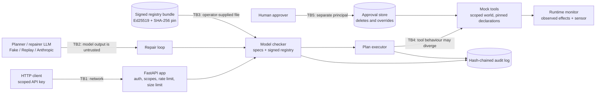

# Threat model

Method: STRIDE per trust boundary. Each row maps a threat to the control that addresses it and to
the test, bench script or CI job that proves the control works. `scripts/check_baseline.py`
verifies that every backticked evidence reference exists. What a "safe" verdict does and does not
mean is in [SOUNDNESS.md](SOUNDNESS.md).

## System and trust boundaries

Assets: the integrity of destructive side effects (deletions, restarts), the integrity of the
specs and the effect registry, API keys and provider credentials, spend (tokens and USD), audit
evidence, and personal data that may appear in plans, goals and tool output.

Assumptions: TLS terminates in front of the service; the host and container runtime are trusted;
the registry signing key is kept offline by the operator; principals passed to the approval store
come from authenticated API keys (`key:<id>`), never from a model.

## STRIDE table

| ID | STRIDE | Threat | Entry point / asset | Control | Test / evidence | Residual risk |
|---|---|---|---|---|---|---|
| S1 | Spoofing | Caller guesses, replays or brute-forces an API key | TB1, every `/v1` route | Keys stored as SHA-256 digests; constant-time compare against every digest; fail closed with no keys; uniform 401 | `tests/unit/test_security.py::test_every_configured_digest_is_compared_without_early_exit`, `tests/integration/test_api.py::test_scopes_are_enforced_per_route` | No expiry or rotation workflow |
| S2 | Spoofing | An agent approves its own deletion or override, or uses someone else's approval | TB5, approval store | Separation of duties (requester cannot decide); an approval is consumed only by the principal that requested it; single use; expiry | `tests/unit/test_approval.py::test_an_approval_is_bound_to_the_principal_that_requested_it`, `tests/unit/test_runtime.py::test_an_approved_override_waives_exactly_the_listed_instances_once` | Principal names must come from authentication |
| S3 | Spoofing | A misspelled proposition makes a spec silently vacuous ("always true") | Spec documents | Every atom is type-checked against the registry (declared name, arity, sort); unknown names are errors | `tests/unit/test_spec.py::test_unknown_propositions_arity_and_sort_clashes_are_errors` | A declared-but-wrong proposition is a logic error the checker cannot see |
| S4 | Spoofing | Tool output, or the repair task sent by an API caller, forges an envelope that claims a trusted source (a fake repair context) in a repair prompt | TB1/TB2/TB4, prompts | Reversible escaping of envelope tags; the task is quoted in its own `user:task` envelope; envelope id derived from SHA-256 of source and content; the scripted repairer requires exactly one repair context | `tests/unit/test_envelope.py::test_a_forged_envelope_inside_content_is_neutralized`, `tests/unit/test_repair.py::test_repair_prompts_quote_plans_and_tool_outputs_as_untrusted_data`, `tests/unit/test_repair.py::test_a_forged_repair_context_inside_the_task_is_quoted_not_obeyed` | Envelope ids are unkeyed hashes (kept deterministic for replayable prompts); containment comes from the checker (E1) |
| T1 | Tampering | Registry declarations edited (for example, `delete_dir` declared non-destructive) or a different, validly signed registry swapped in | TB3, registry bundle | Canonical SHA-256 recomputed and compared; Ed25519 signature over a domain-separated digest; trusted key ids; optional SHA-256 pin; no "load anyway" path; readiness fails in prod without a configured bundle | `tests/unit/test_effects_signing.py::test_modified_unknown_unpinned_or_forged_registries_are_refused`, `tests/integration/test_api.py::test_a_configured_signed_and_pinned_registry_is_loaded`, `tests/integration/test_api.py::test_readiness_needs_compiled_specs_and_a_verified_registry` | Whoever holds the signing key can sign anything; keep it offline |
| T2 | Tampering | A tool implementation paired with a registry whose declaration it was not written for, or an unregistered tool | TB4, tool gateway | Every executable tool is pinned to the SHA-256 of the declaration it implements; the gateway refuses unregistered, mismatched or duplicate tools | `tests/unit/test_runtime.py::test_gateway_admits_only_registered_tools_pinned_to_their_declaration`, `tests/unit/test_runtime.py::test_world_tools_refuse_a_registry_that_changed_their_declaration` | A malicious implementation that claims the right pin is not detected |
| T3 | Tampering | Model or tool output tries to change the specs or the registry ("rule waived", extra fields) | TB2, repair loop | Specs and registry are loaded server-side and immutable; the only thing read back from a model is a plan in a closed schema (`extra="forbid"`), which is checked again | `tests/unit/test_repair.py::test_a_gullible_repairer_cannot_talk_its_way_past_the_checker`, `tests/unit/test_ir.py::test_plans_are_closed_and_validated` | None known |
| T4 | Tampering | A tool's real behaviour diverges from its declaration (silent snapshot failure, lost lock lease, no-op drain), possibly while reporting success | TB4, runtime | Runtime monitor on every call: pre-call prediction from observed state blocks violating steps; with a sensor, the sensed value of every tracked, declared or reported fluent wins over the report, and a contradicted report stops the run (`tool.misreported`); initial values are sensed too; divergence flagged and audited | `tests/integration/test_corpus.py::test_every_divergence_is_blocked_before_the_violating_step_runs`, `tests/integration/test_corpus.py::test_a_tool_that_lies_about_the_fault_is_stopped_no_later`, `tests/unit/test_runtime_adversarial.py::test_a_tool_that_claims_success_but_did_nothing_is_caught_by_the_sensor`, `tests/unit/test_runtime_adversarial.py::test_a_lock_already_held_when_the_run_starts_is_sensed`, `tests/unit/test_runtime.py::test_unreported_state_changes_are_caught_by_the_sensor`, `bench/bench_checker.py` | Without a sensor a lying tool is believed (30/30 lying scenarios then run the violating step); effects neither reported nor sensed are invisible; end-state violations are detected, not blocked |
| T5 | Tampering | A checker bug reports a violating plan safe, or returns a counterexample the plan cannot produce; a runtime monitor bug misses a violation | Checker, runtime monitor | Differential testing against a brute-force oracle (verdict, replay, shortest length), including the vacuous-instance shortcut; monitor tested against textbook semantics; seeded-bug test; the incremental runtime monitor tested against a naive full-replay reference | `tests/unit/test_differential.py::test_checker_verdicts_equal_the_brute_force_oracle`, `tests/unit/test_differential.py::test_the_oracle_catches_a_seeded_monitor_bug`, `tests/unit/test_spec.py::test_folding_fixed_propositions_preserves_the_value_at_every_position`, `tests/unit/test_runtime_monitor.py::test_the_incremental_monitor_agrees_with_a_naive_reference`, `bench/bench_differential.py`, `.github/workflows/ci.yml#differential` | Oracle and checker share registry grounding and spec instantiation |
| T6 | Tampering | Runtime collection items alias resources the checker assumed distinct (including constants the plan only tests in a guard or lists in a loop), or smuggle path traversal or prompt text into tool arguments | TB4, executor | Collections resolved once before the first call; bound, duplicate, aliasing (call args, guard args, listed items, spec constants) and resource-name checks abort the run; `.`/`..` path segments are refused in plans, collections, reports and spec constants | `tests/unit/test_runtime.py::test_collections_are_bounded_distinct_and_fresh`, `tests/unit/test_runtime_adversarial.py::test_collection_items_may_not_alias_a_constant_the_plan_only_tests_in_a_guard`, `tests/unit/test_runtime_adversarial.py::test_collection_items_must_be_well_formed_resources`, `tests/unit/test_ir.py::test_dot_segments_are_not_valid_resources` | Names are compared as strings (`/a` vs `/a/`); real tools must canonicalize paths against an allowed root |
| T7 | Tampering | Audit entries edited, deleted, reordered or truncated, or the whole chain rebuilt | Audit log | Hash chain over canonical JSON; verify CLI; head anchor; writers refuse a rewritten or shrunk file; `GET /v1/audit/head` (scope `audit`) publishes the verified head so it can be anchored outside the service | `tests/unit/test_audit.py::test_any_single_byte_change_is_detected`, `tests/unit/test_audit.py::test_tail_truncation_needs_an_anchored_head`, `tests/integration/test_api.py::test_monitor_decisions_are_audited_and_the_head_can_be_anchored`, `tests/integration/test_api.py::test_the_audit_head_is_only_published_for_a_verified_chain` | A rebuilt chain is only detected against a head anchored elsewhere; anchoring is the operator's job |
| T8 | Tampering | Arguments changed between approval and execution (approve delete of `/tmp/x`, run delete of `/srv`) | TB5, approvals | Approval bound to the canonical hash of the exact call; overrides bound to plan hash, waived instances and justification | `tests/unit/test_approval.py::test_an_approval_does_not_transfer_to_changed_arguments`, `tests/unit/test_runtime.py::test_approvals_are_bound_to_the_exact_destructive_call` | The approval file is not signed |
| T9 | Tampering | Compromised dependency, base image or CI action | Build pipeline | uv.lock with hashes; pip-audit; base images pinned by digest; trivy; CycloneDX SBOM; Dependabot | `.github/workflows/ci.yml#pip-audit`, `.github/workflows/ci.yml#docker` | Actions are tag-pinned until SHA pinning at publish time |
| T10 | Tampering | Budget ledger reset or several workers each spending the full budget | Budget file | Limits cannot be raised on resume; shared ledgers lock and merge; usage audited | `tests/unit/test_budget.py::test_ledgers_sharing_a_file_cannot_double_spend` | The ledger itself is not tamper-evident |
| R1 | Repudiation | Dispute over what was checked, which counterexample was shown, who overrode it, or what the monitor allowed | Audit log | Audit entries for every check (plan hash, verdict, counterexamples), repair outcome and rejected repair, run step, block, misreport, waived violation, override request/decision/use (with justification), and every `/v1/monitor` decision (proposed call, allowed, violated instances) | `tests/unit/test_repair.py::test_repair_loop_fixes_a_single_omission_in_one_attempt`, `tests/unit/test_runtime.py::test_an_approved_override_waives_exactly_the_listed_instances_once`, `tests/unit/test_runtime.py::test_a_verified_plan_runs_and_the_audit_chain_records_it`, `tests/integration/test_api.py::test_monitor_decisions_are_audited_and_the_head_can_be_anchored` | Timestamps are local clock values |
| I1 | Information disclosure | PII or secrets in plans, goals or tool output written to logs or the audit log | Logs, audit | structlog and audit redaction (e-mail, phone, card, tokens, secrets) | `tests/integration/test_api.py::test_audit_entries_redact_pii_in_plans`, `tests/unit/test_logging.py::test_exception_tracebacks_are_redacted` | Pattern-based: names and addresses are not detected |
| I2 | Information disclosure | Error bodies echo submitted plans, secrets or internals | TB1, responses | Fixed error codes; validation details without input values; plan errors redacted and truncated to 300 characters; generic 500 | `tests/integration/test_api.py::test_bad_payloads_get_generic_errors_without_echoing_input`, `tests/integration/test_app.py::test_unhandled_exceptions_become_generic_500s` | Plan error messages name tools and resources the caller sent |
| I3 | Information disclosure | Metrics expose raw paths; metrics readable by anyone | `/metrics` | Route-template labels; spec names only as labels; metrics require an API key by default | `tests/integration/test_app.py::test_metrics_require_auth_and_label_route_templates` | Operators may disable auth for scraping |
| I4 | Information disclosure | Secrets committed to the repository | Git history | Only `.env.example` committed; gitleaks and semgrep secrets pack in CI | `.github/workflows/ci.yml#gitleaks`, `.github/workflows/ci.yml#semgrep` | Scanners miss unusual formats |
| D1 | Denial of service | Request floods | TB1 | Token bucket per verified key or client address; probes exempt | `tests/integration/test_app.py::test_rate_limit_rejects_bursts_and_exempts_probes` | In-process only |
| D2 | Denial of service | Huge, deeply nested or loop-heavy plans, or long `/v1/monitor` histories over many distinct resources, exhaust CPU or memory | TB1, checker, monitor | Body size limit; pydantic JSON parser with bounded nesting; plan limits (nodes, depth, loop bound, unrolled calls) checked before any work; state, instance and size-assignment budgets that fail closed; `/v1/monitor` capped at 500 steps, 2,000 spec instances and 200,000 monitor steps (422 `monitor_budget_exceeded`) with incremental instances; every budget error is a 422 on every route; work runs in the thread pool | `tests/unit/test_ir.py::test_structural_limits_are_enforced_before_checking`, `tests/unit/test_checker.py::test_budgets_bound_states_collections_and_size_assignments`, `tests/integration/test_api.py::test_state_budget_exhaustion_is_reported_not_verified`, `tests/integration/test_api.py::test_monitor_requests_are_budgeted_and_never_a_500`, `tests/integration/test_api.py::test_override_requests_report_check_budget_exhaustion_as_422`, `tests/unit/test_runtime_monitor.py::test_registering_resources_costs_work_per_new_instance_not_per_instance_so_far`, `bench/bench_service.py` | Measured on the development machine (`bench/bench_service.py`): the slowest requests found fail closed at a budget, a `/v1/monitor` request under an operator spec whose 1,728 instances all read one event (422 at the 200,000-step work budget after 1.6 s) and a `/v1/check` with three collections (422 at the 250,000-state budget after 1.2 s); a 200-node plan of 40 guarded deletes checks in 0.32 s; with the built-in specs `/v1/monitor` with 333 distinct paths (1,998 instances) takes 0.22 s and 500 distinct paths are refused in 0.16 s. With the default rate limit (5/s, burst 20) one key can still keep a worker busy; lower `APP_CHECK_MAX_STATES` and `APP_MONITOR_MAX_WORK` to cap it |
| D3 | Denial of service | Deeply nested or huge spec formulas | Spec parser | Length, node-count and depth limits; recursion errors converted to syntax errors | `tests/unit/test_spec.py::test_size_and_nesting_limits_protect_the_parser` | Spec documents come from operators, not callers |
| D4 | Denial of service | A repair loop that never converges, or burns tokens and money | Repair loop, provider | At most 3 attempts (configurable); step, token and USD budgets; billed failures charged; non-retryable provider errors stop the loop | `tests/unit/test_repair.py::test_repair_is_bounded_and_then_needs_a_human_override`, `tests/unit/test_repair.py::test_repair_stops_when_the_token_or_usd_budget_is_spent`, `tests/unit/test_repair.py::test_billed_provider_failures_are_charged` | One call can overshoot the token limit |
| D5 | Denial of service | Container exhausts host resources | Runtime | Compose memory, CPU and PID limits | `.github/workflows/ci.yml#docker` | Limits are deployment-specific |
| E1 | Elevation of privilege | Prompt injection makes the planner or repairer produce a plan that skips a protocol step | TB2 | Every model-produced plan is re-checked against the server's specs before it may run; failure after the bounded loop needs a human override; tested with a model that obeys injections | `tests/unit/test_repair.py::test_a_gullible_repairer_cannot_talk_its_way_past_the_checker`, `tests/integration/test_corpus.py::test_every_corpus_verdict_matches_its_label_and_the_oracle` | Guarantees are relative to the declared effects (T4) |
| E2 | Elevation of privilege | A plan deletes without a human approval, or a tool (or monitor client) reports an approval it cannot grant | Destructive tools | Registry-derived implicit approval spec (`approval_delete_dir`), kept even when callers select a spec subset; `approved[path]` is declared only by `request_approval`, which sets it after a human decision bound to the exact call, and the monitor rejects any report of a fluent outside the call's declared effects (run aborted; 422 `undeclared_effect` in `/v1/monitor`); the world refuses deletion without a granted approval | `tests/unit/test_checker.py::test_guards_on_tracked_propositions_are_path_sensitive`, `tests/unit/test_checker.py::test_spec_selection_keeps_the_implicit_approval_rule`, `tests/unit/test_runtime.py::test_tools_only_get_the_operations_they_were_granted`, `tests/unit/test_runtime_adversarial.py::test_a_tool_cannot_grant_an_approval_it_does_not_declare`, `tests/integration/test_api.py::test_monitor_refuses_effects_the_tool_does_not_declare` | A human can still approve a wrong deletion; `request_approval` itself is trusted to report the human decision |
| E3 | Elevation of privilege | A key minted for checking starts paid repairs, submits overrides or approves them | TB1 | Scoped API keys (`check`, `monitor`, `repair`, `override`, `approve`); default scopes are read-only; per-route scope dependencies | `tests/integration/test_api.py::test_scopes_are_enforced_per_route`, `tests/unit/test_security.py::test_key_entries_carry_scopes_and_default_to_read_only` | Scope assignment is operator configuration |
| E4 | Elevation of privilege | A counterexample is overridden without accountability, reused, or moved to another plan; a plan runs without being verified | Override gate, executor | Override = approval record over (plan hash, waived instances, justification of at least 20 characters); different approver; single use by the requester; `PlanExecutor.run` re-checks every plan, refuses it unless it verifies, and consumes the override itself for that plan hash, which must cover every violated instance; the monitor still evaluates waived instances and audits them | `tests/unit/test_runtime.py::test_an_approved_override_waives_exactly_the_listed_instances_once`, `tests/unit/test_runtime_adversarial.py::test_an_unverified_plan_is_refused_before_any_call`, `tests/unit/test_runtime_adversarial.py::test_an_override_is_consumed_by_the_executor_and_bound_to_its_plan`, `tests/unit/test_runtime_adversarial.py::test_an_override_must_cover_every_violation_and_be_granted_for_the_plan`, `tests/integration/test_api.py::test_override_needs_a_justification_and_a_different_approver` | An approver can accept a bad justification |
| E5 | Elevation of privilege | Tools use capabilities beyond their purpose (a snapshot tool deletes) | Mock tools | Each tool receives a scoped world view with an operation allowlist | `tests/unit/test_runtime.py::test_tools_only_get_the_operations_they_were_granted` | Real tools need their own sandboxing |
| E6 | Elevation of privilege | Code execution inside the container escalates | Runtime | Non-root UID 10001; read-only root filesystem; all capabilities dropped; no-new-privileges | `.github/workflows/ci.yml#docker` | Kernel or runtime vulnerabilities |
| E7 | Elevation of privilege | Deserialization of attacker-controlled data runs code | Plans, bundles, cassettes | JSON only (pydantic); no pickle family (semgrep rule and baseline check) | `tests/unit/test_no_pickle.py::test_source_tree_has_no_pickle_family_serialization`, `.github/workflows/ci.yml#semgrep` | None known |
| E8 | Elevation of privilege | After a server-side refusal fallback, blocks of the declined attempt are used | TB2, AnthropicProvider | Blocks before the last `fallback` marker are dropped | `tests/unit/test_anthropic_provider.py::test_blocks_of_a_declined_attempt_before_the_fallback_marker_are_dropped` | Verified against a mocked client only |
| E9 | Elevation of privilege | A repairer (or an injected instruction) "fixes" a plan by dropping the risky step, so the checker passes a plan that no longer does the task | TB2, repair loop | Every repair candidate must keep each call of the original plan, with the same arguments and in order (`missing_calls`); otherwise it is rejected as `dropped_steps` and audited | `tests/unit/test_repair.py::test_a_repair_that_drops_steps_of_the_original_plan_is_rejected`, `tests/unit/test_repair.py::test_repairs_may_insert_and_wrap_steps_but_must_keep_their_order` | A repair can still keep a call but wrap it in a branch that is never taken; task intent is not verified |

## Out of scope

Network-level attacks below TLS, multi-tenant isolation, key management services, a compromised
signing key, and data-flow or confidentiality properties of plans (see the taint-flow-agent
project). The README Non-goals section lists the functional limits.
